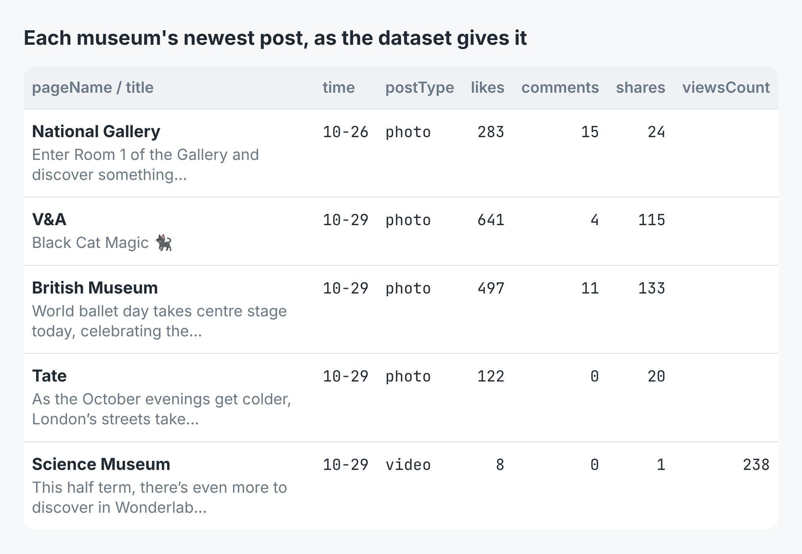

# Facebook page engagement scraper: compare pages post by post

Give it the URLs of public Facebook pages, your own and the ones you measure
yourself against, and get each page's latest posts with their reactions,
comments, shares and video views. The script ranks the pages by the median
reactions + comments + shares a post drew and writes every post to a CSV.

These scripts call [Facebook Page Scraper](https://apify.com/simple.actor/facebook-page-posts)
on Apify. No Facebook login, no cookies and no browser is needed.


The write-up, with a real run on seven London museums, is
[How to compare Facebook engagement between pages](https://simple-actor.github.io/compare-facebook-engagement-between-pages-london-museums/)

## Run it

You need an [Apify](https://apify.com) account and its API token, from
Console → Settings → API & Integrations.

**Node** (22 or newer, for `Map.groupBy`):

```bash
cd node
npm install
APIFY_TOKEN=your_token node engagement.mjs https://www.facebook.com/tategallery https://www.facebook.com/britishmuseum
```

**Python** (3.11 or newer):

```bash
cd python
python -m venv .venv && . .venv/bin/activate
pip install -r requirements.txt
APIFY_TOKEN=your_token python engagement.py https://www.facebook.com/tategallery https://www.facebook.com/britishmuseum
```

The arguments are the page URLs. Vanity (`facebook.com/tategallery`), numeric
(`profile.php?id=…`) and `m.facebook.com` links all work. The scripts print one
line per page, best first, and write `posts.csv`:

```
    454  Tate (8 posts since 2026-10-20) https://www.facebook.com/tategallery
8 posts written to posts.csv
```

Check the page name on each line against the page you meant. In the run
behind the post, `facebook.com/sciencemuseum` turned out to be the Science
Museum of Minnesota; London's is `facebook.com/sciencemuseumlondon`.

## What a row looks like

[`sample-output.json`](sample-output.json) holds three real rows from the
museums run, with every field except `topComments`, which carries commenters'
names and is left out here.



The fields you will use most:

| Field | What it holds |
|---|---|
| `pageName`, `facebookUrl` | The page's own name, and the URL you asked for |
| `time`, `timestamp` | When the post went up, on every post |
| `postType` | `photo`, `video`, `link` or `text` |
| `likes` | Every reaction, of all types; one column per type in `reactionLikeCount` … `reactionCareCount` |
| `comments`, `shares` | Facebook's counts for the post |
| `viewsCount` | Views, on video posts; null on the others |
| `title`, `text` | Facebook's headline for the post, and the full text |
| `isShare`, `sharedPost` | A share of another page's post, and which one |
| `url` | The post's permalink |
| `error`, `errorDescription` | Only on a row for a page that could not be read |

## Cost

$0.003 a run and $0.001 for each post returned. Rows for pages that could not
be read are not charged. The museums comparison read 64 posts in two runs,
$0.07, and the follower counts in `details` mode, $0.004 a page, added $0.028.

## Limits

- **At most 8 posts a page.** That is what Facebook serves a logged-out reader
  in one request; asking again returns the same posts. Run it on a schedule
  and keep the rows for a longer history.
- **Facebook rate-limits the read.** A refused page comes back as a
  `read_failed` row and the run still succeeds. Re-run it a few minutes later,
  and spread the runs out when you track many pages.
- **Private, restricted or removed pages** come back as a `not_available` row.
- **Follower counts are rounded** ("1.4M followers"), in `details` mode.
